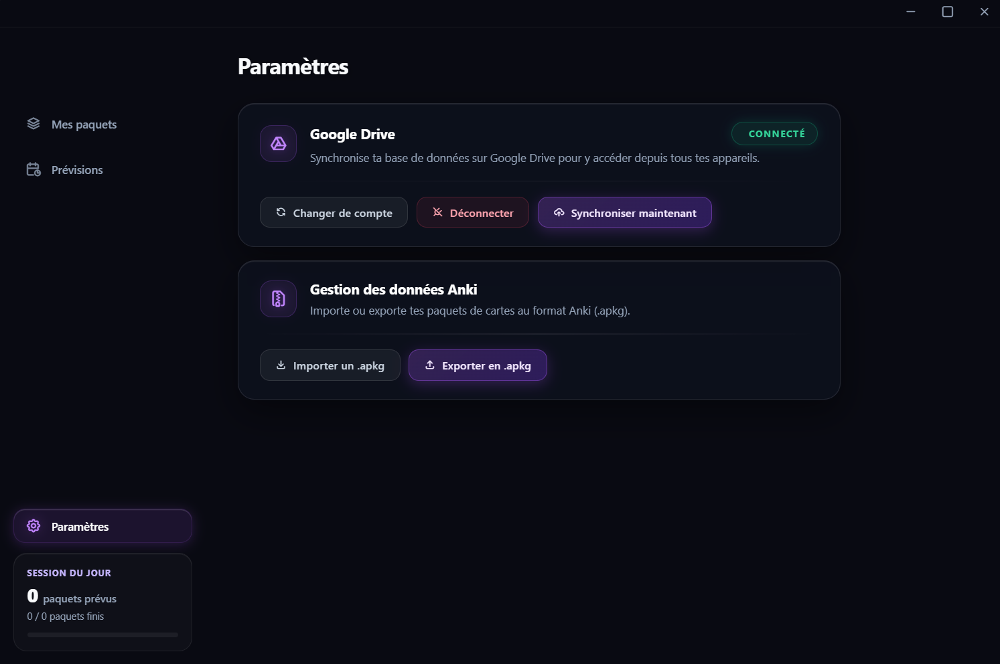
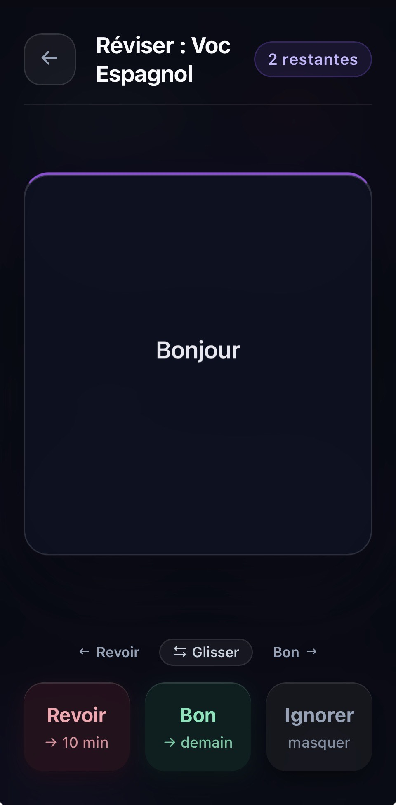
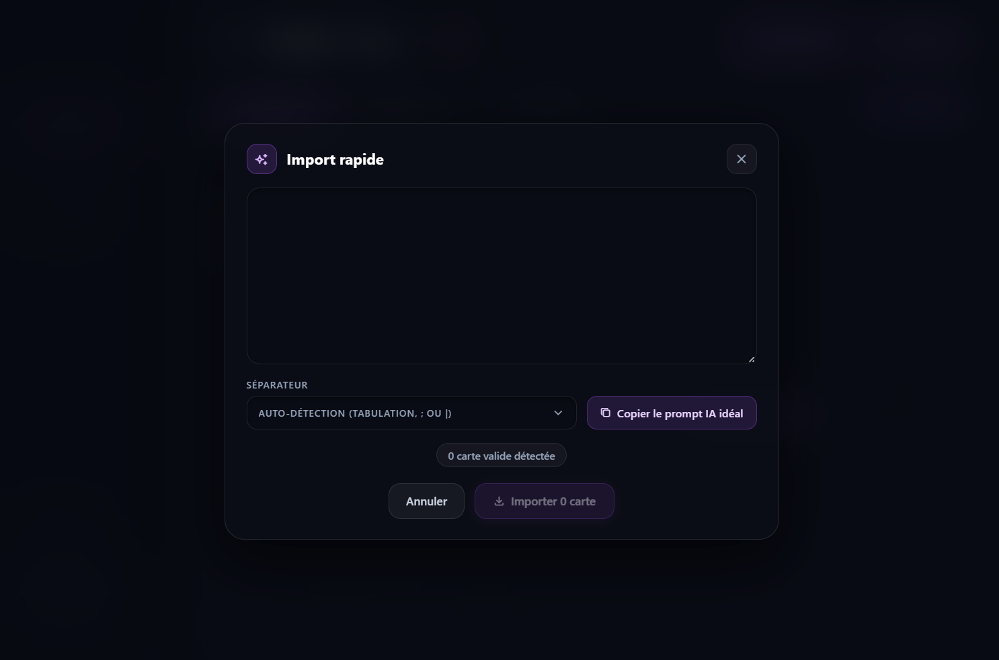
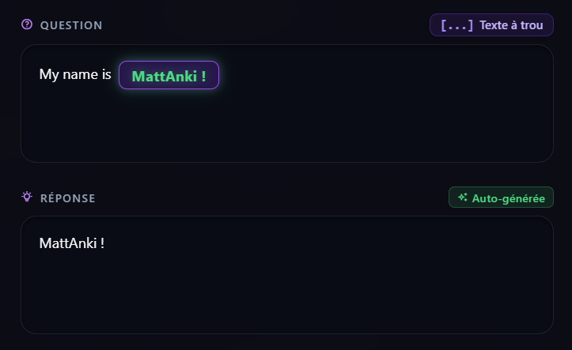

<div align="center">


<p>
  <a href="#-démo-vidéo">Démo Vidéo</a> &nbsp;&bull;&nbsp;
  <a href="#-le-socle-gratuit">Socle Gratuit</a> &nbsp;&bull;&nbsp;
  <a href="#-version-mobile-pwa">Mobile PWA</a> &nbsp;&bull;&nbsp;
  <a href="#-mattanki-pro">MattAnki Pro</a> &nbsp;&bull;&nbsp;
  <a href="#-confidentialité--licence">Confidentialité &amp; Licence</a> &nbsp;&bull;&nbsp;
  <a href="#-téléchargement--installation">Télécharger</a>
</p>

<br/>

<p>
  &nbsp;
  &nbsp;
  
</p>

<h1>Ne laissez plus un algorithme décider de votre réussite.</h1>

<p>
  Les logiciels classiques repoussent vos cartes à 30 jours et vous cachent votre cours juste avant l'examen.<br/>
  <b>MattAnki vous garantit de revoir 100 % de vos cartes actives chaque jour jusqu'au jour J.</b>
</p>

<br/>

<p>
  <a href="https://neplexx.github.io/MattAnki/"></a>&nbsp;&nbsp;
  <a href="https://github.com/neplexx/MattAnki/releases"></a>&nbsp;&nbsp;
  <a href="https://neplexx-mattanki.lemonsqueezy.com/checkout/buy/1d3cb67f-45f0-4136-8542-e5457ff25e4a"></a>
</p>

<br/>


</div>

<br/>

<!-- BARRE DE VALEURS EN 3 COLONNES -->
<table width="100%">
  <tr>
    <td width="33%" valign="top" align="center">
      <h3>100 % Déterministe</h3>
      <p>Fini les cartes programmées un mois après votre partiel. Chaque paquet actif est travaillé <b>intégralement tous les jours</b> jusqu'au jour J, avec bouton <b>Avancé</b> hors-planning.</p>
    </td>
    <td width="33%" valign="top" align="center">
      <h3>Socle Complet Gratuit</h3>
      <p>Créez vos cartes, collez vos schémas en direct avec <kbd>Ctrl</kbd>+<kbd>V</kbd>, importez vos paquets Anki <code>.apkg</code> et synchronisez via <b>Google Drive</b> dès la version gratuite.</p>
    </td>
    <td width="33%" valign="top" align="center">
      <h3>Pro à 3,99 € à vie</h3>
      <p>Débloquez les <b>Examens Blancs notés sur 20</b>, l'<b>Import IA</b> en masse, les <b>Textes à trous</b> et l'illimité en un <b>paiement unique</b> sans abonnement.</p>
    </td>
  </tr>
</table>

<br/>

---

<!-- VIDEO PC PLEINE LARGEUR (TETE D'AFFICHE) -->
<div align="center">
  <p></p>
  <h2 id="-démo-vidéo">MattAnki sur Ordinateur — En Action</h2>
  <p>Propulsé par <b>Rust</b> et <b>Tauri v2</b> (&lt; 50 Mo RAM) avec base de données <b>SQLite</b> locale ultra-rapide.</p>
</div>

<br/>

https://github.com/user-attachments/assets/04562486-227f-4f94-becc-a1a82fda2b4e

<br/>

---

<div align="center">
  <h2 id="-le-socle-gratuit">1. Le Socle MattAnki — Inclus gratuitement</h2>
  <p>Tout ce dont vous avez besoin au quotidien pour créer, illustrer et synchroniser vos révisions sans débourser un centime.</p>
</div>

<br/>

<!-- FEATURE 1 : COLLAGE CTRL+V & CARTES SKIPEES -->
<table width="100%">
  <tr>
    <td width="62%" valign="middle" align="center">
      
    </td>
    <td width="38%" valign="middle">
      <p></p>
      <h3>Collage d'images direct (<kbd>Ctrl</kbd>+<kbd>V</kbd>) &amp; Cartes Skipées</h3>
      <p><b>Illustrez vos cours à la vitesse de l'éclair.</b></p>
      <ul>
        <li>Capturez un schéma de polycopié et faites <kbd>Ctrl</kbd>+<kbd>V</kbd> directement dans la Question ou la Réponse, sans enregistrer de fichier.</li>
        <li>Carte connue sur le bout des doigts ? Écartez-la d'une touche vers l'onglet <b>Skipées</b> pour alléger vos séances, tout en restant réactivable en 1 clic.</li>
      </ul>
    </td>
  </tr>
</table>

<br/>

<!-- FEATURE 2 : REVISION CLAVIER & MODE AVANCE -->
<table width="100%">
  <tr>
    <td width="38%" valign="middle">
      <p></p>
      <h3>Révision pilotée au clavier &amp; Mode Avancé</h3>
      <p><b>Zéro distraction. Uniquement vous et votre cours.</b></p>
      <ul>
        <li><kbd>Espace</kbd> : retourner la carte</li>
        <li><kbd>1</kbd> : <b>Revoir dans 10 minutes</b></li>
        <li><kbd>2</kbd> : <b>Valider à demain</b></li>
        <li><kbd>3</kbd> : <b>Ignorer (Skip)</b></li>
      </ul>
      <blockquote>
        <b>Bouton Avancé :</b> Envie de prendre de l'avance ou de refaire un tour complet la veille du partiel ? Débloquez la session du lendemain en un clic.
      </blockquote>
    </td>
    <td width="62%" valign="middle" align="center">
      
    </td>
  </tr>
</table>

<br/>

<!-- FEATURE 3 : COMPATIBILITE ANKI & GOOGLE DRIVE -->
<table width="100%">
  <tr>
    <td width="62%" valign="middle" align="center">
      
    </td>
    <td width="38%" valign="middle">
      <p></p>
      <h3>Compatibilité Anki (<code>.apkg</code>) &amp; Synchro Google Drive</h3>
      <p><b>Vos paquets vous suivent partout, en toute confidentialité.</b></p>
      <ul>
        <li>Importez les paquets Anki (<code>.apkg</code>) de votre fac ou prépa et exportez vos créations pour vos camarades.</li>
        <li>Reliez <b>Google Drive</b> en un clic : paquets, images et progression sont sauvegardés dans votre espace privé <code>appDataFolder</code> entre PC et mobile.</li>
      </ul>
    </td>
  </tr>
</table>

<br/>

<!-- MOBILE PWA SHOWCASE -->
<div align="center">
  <h3 id="-version-mobile-pwa">Également inclus gratuitement sur Smartphone (iOS &amp; Android)</h3>
  <p>Installez la Web App sur votre écran d'accueil pour réviser hors-ligne dans les transports.</p>
</div>

<table width="100%">
  <tr>
    <td width="33%" align="center" valign="top">
      
      <h4>Gestes Tactiles Intuitifs</h4>
      <p>Glissez à gauche pour <b>Revoir (10 min)</b> ou à droite pour <b>Valider (Demain)</b>.</p>
    </td>
    <td width="33%" align="center" valign="top">
      
      <h4>Édition &amp; Tri Mobile</h4>
      <p>Recherche instantanée par mot-clé, édition rapide et gestion des cartes <b>Actives / Skipées</b>.</p>
    </td>
    <td width="33%" align="center" valign="top">
      
      <h4>Agenda (« Prévisions »)</h4>
      <p>Planifiez vos paquets sur la semaine et suivez votre barre d'objectif quotidien.</p>
    </td>
  </tr>
</table>

<br/>

---

<!-- SECTION PRO : HERO BLENDER PRO.PNG -->
<div align="center">
  <p></p>
  <h2 id="-mattanki-pro">2. Passez à la vitesse supérieure avec MattAnki Pro</h2>
  <p>
    Testez l'intégralité du socle gratuitement (jusqu'à 2 paquets actifs, 50 cartes créées et 50 révisions d'essai par paquet).<br/>
    <b>Pour 3,99 € en paiement unique (sans abonnement), débloquez l'illimité et 3 accélérateurs exclusifs :</b>
  </p>
  <br/>
  <a href="https://neplexx-mattanki.lemonsqueezy.com/checkout/buy/1d3cb67f-45f0-4136-8542-e5457ff25e4a">
    
  </a>
</div>

<br/>

<!-- PRO FEATURE 1 : EXAMEN BLANC -->
<table width="100%">
  <tr>
    <td width="62%" valign="middle" align="center">
      
    </td>
    <td width="38%" valign="middle">
      <p></p>
      <h3>Mode Examen Blanc noté sur 20</h3>
      <p><b>Testez-vous dans les conditions réelles du partiel.</b></p>
      <ul>
        <li>Tirage aléatoire de <b>10, 20 ou 50 questions</b> avec chronomètre optionnel par carte (15s, 30s, 60s).</li>
        <li><b>Note finale sur 20</b>, temps moyen par réponse et mode <b>rejouer uniquement les erreurs</b> — sans jamais dérégler votre planning quotidien.</li>
      </ul>
    </td>
  </tr>
</table>

<br/>

<!-- PRO FEATURE 2 : IMPORT IA -->
<table width="100%">
  <tr>
    <td width="38%" valign="middle">
      <p></p>
      <h3>Import IA &amp; Texte en un clic</h3>
      <p><b>Transformez votre cours en 50 cartes en dix secondes.</b></p>
      <ul>
        <li>Copiez le <b>prompt IA pré-configuré</b> intégré, donnez votre cours à <b>ChatGPT ou Claude</b>, et collez le résultat.</li>
        <li>Détection automatique du format (point-virgule, tabulation <b>Quizlet</b> ou <b>Excel</b>) avec aperçu en direct avant création.</li>
      </ul>
    </td>
    <td width="62%" valign="middle" align="center">
      
    </td>
  </tr>
</table>

<br/>

<!-- PRO FEATURE 3 : TEXTES A TROUS -->
<table width="100%">
  <tr>
    <td width="62%" valign="middle" align="center">
      
    </td>
    <td width="38%" valign="middle">
      <p></p>
      <h3>Textes à trous rapides (<kbd>Ctrl</kbd>+<kbd>Shift</kbd>+<kbd>C</kbd>)</h3>
      <p><b>Idéal pour les définitions exactes, formules et articles de loi.</b></p>
      <ul>
        <li>Surlignez n'importe quel mot-clé et cliquez sur <b><code>[...] Texte à trou</code></b>.</li>
        <li>MattAnki génère automatiquement la réponse associée et transforme le mot ciblé en badge masqué pendant vos révisions.</li>
      </ul>
    </td>
  </tr>
</table>

<br/>

### Comparatif : Version Découverte vs MattAnki Pro

| Fonctionnalité | Découverte (0 €) | MattAnki Pro (3,99 € à vie) |
| :--- | :--- | :--- |
| **Cycle quotidien déterministe &amp; Mode Avancé** | Inclus gratuitement | **Inclus** |
| **Collage d'images (`Ctrl + V`) &amp; Recherche** | Inclus gratuitement | **Inclus** |
| **Planificateur hebdomadaire (Prévisions)** | Inclus gratuitement | **Inclus** |
| **Synchronisation Cloud (PC, Mac, Linux, iOS, Android)** | Inclus gratuitement | **Inclus + Propagation Pro auto via Drive** |
| **Import / Export Anki (`.apkg`)** | Jusqu'à 2 paquets | **Illimité (sans aucun plafond)** |
| **Nombre de paquets actifs** | Jusqu'à 2 paquets | **Paquets illimités** |
| **Création manuelle de cartes** | Jusqu'à 50 cartes | **Cartes et images illimitées** |
| **Volume de révisions par paquet** | 50 révisions d'essai / paquet | **Révisions quotidiennes 100 % illimitées** |
| **Mode Examen Blanc chronométré &amp; Note sur 20** | — | **Inclus (relecture ciblée des erreurs)** |
| **Import rapide en masse (ChatGPT, Claude, Quizlet)** | — | **Inclus (prompt IA intégré)** |
| **Création de Textes à trous (`[...]`)** | Lecture seule | **Création en 1 clic (`Ctrl + Shift + C`)** |

<br/>

<div align="center">

| Solution du marché | Modèle économique | Coût réel pour l'étudiant |
| :--- | :--- | :--- |
| **AnkiMobile (iOS)** | Achat unique App Store | **29,99 €** (iPhone / iPad uniquement) |
| **Quizlet Plus / Apps SaaS** | Abonnement récurrent | **35,99 € à 45 € / an** (&gt; 100 € sur 3 ans) |
| **MattAnki Pro** | **Paiement unique — Accès à vie** | **3,99 € une seule fois** (PC, Mac, Linux, iOS, Android) |

</div>

<br/>

---

<div align="center">
  <h2 id="-confidentialité--licence">Confidentialité « Zero-Knowledge » &amp; Licence Pro</h2>
  <p>Vos cours vous appartiennent à 100 %. MattAnki n'a aucun serveur intermédiaire et ne peut jamais lire vos données.</p>
</div>

<table width="100%">
  <tr>
    <td width="50%" valign="top">
      <h3>Architecture Google Drive Privée</h3>
      <pre>
[ App PC (Tauri / Rust) ] ◄──────┐
                                 ▼
              [ Google Drive : appDataFolder ]
              (Conteneur isolé, privé, caché)
                                 ▲
[ Web / PWA (SQLite WASM) ] ◄────┘</pre>
      <ul>
        <li><b>Aucun serveur tiers :</b> vos données transitent uniquement entre vos appareils et votre propre Google Drive.</li>
        <li><b>Permission restreinte <code>drive.appdata</code> :</b> MattAnki ne peut ni voir, ni modifier vos autres fichiers Drive.</li>
        <li><b>C'est pour cela que Pro coûte 3,99 € à vie :</b> zéro coût de serveur cloud mensuel à vous refacturer.</li>
      </ul>
    </td>
    <td width="50%" valign="top">
      <h3>Activation &amp; Sécurité de la Licence</h3>
      <pre>
1. Paiement LemonSqueezy (3,99 €)
   │  (Stripe / PayPal / Apple Pay)
   ▼
2. Clé instantanée : XXXX-XXXX-XXXX-XXXX
   │  (Paramètres &gt; Licence)
   ▼
3. Propagation auto via Drive + Offline SHA-256</pre>
      <ul>
        <li><b>100 % Hors-Ligne après activation :</b> signature cryptographique locale (<code>SHA-256</code>) active en avion ou en amphi.</li>
        <li><b>Multi-appareils automatique :</b> connectez Google Drive et votre téléphone passe en Pro tout seul.</li>
        <li><b>Double sauvegarde :</b> SQLite locale + <code>appDataFolder</code>, avec bouton <b>Délier la licence</b> en 1 clic.</li>
      </ul>
    </td>
  </tr>
</table>

<br/>

---

<div align="center">
  <h2 id="-téléchargement--installation">Téléchargement &amp; Installation</h2>
</div>

| Plateforme | Format | Lien direct |
| :--- | :--- | :--- |
| **Navigateur &amp; Mobile (PWA)** | Application Web progressive (iOS, Android, PC) | [**Ouvrir neplexx.github.io/MattAnki**](https://neplexx.github.io/MattAnki/) |
| **Windows** | Installateur `.exe` / `.msi` | [**Télécharger depuis GitHub Releases**](https://github.com/neplexx/MattAnki/releases) |
| **macOS** | Image disque `.dmg` | [**Télécharger depuis GitHub Releases**](https://github.com/neplexx/MattAnki/releases) |
| **Linux** | Paquets `.deb` / `.AppImage` | [**Télécharger depuis GitHub Releases**](https://github.com/neplexx/MattAnki/releases) |
| **Licence MattAnki Pro** | Clé d'activation à vie (Multi-appareils) | [**Acheter une clé officielle (3,99 €)**](https://neplexx-mattanki.lemonsqueezy.com/checkout/buy/1d3cb67f-45f0-4136-8542-e5457ff25e4a) |

<br/>

<details>
<summary><b>Spécifications du Protocole de Révision Quotidienne (Comparatif Anki SM-2 vs MattAnki) — Cliquer pour dérouler</b></summary>
<br/>

Les algorithmes d'espacement exponentiel (SM-2, FSRS) sont pensés pour étaler l'apprentissage sur plusieurs années : avant un partiel, **une carte réussie est repoussée à 15 ou 30 jours, sautant les derniers jours critiques précédant l'épreuve.**

MattAnki remplace les courbes d'oubli opaques par un **double ancrage le premier jour**, suivi d'une **consolidation quotidienne directe** :

```text
[ JOUR 1 : DÉCOUVERTE & ANCRAGE ]
   │
   ├── 1. Première réussite ("Bon") ──────────► Rappel de sécurité à 10 minutes
   │                                            (Vérification de l'ancrage immédiat)
   │
   └── 2. Confirmation après 10 min ("Bon") ──► Carte validée pour aujourd'hui
                                                Programmée automatiquement à DEMAIN
                                                           │
                                                           ▼
[ JOURS SUIVANTS : CONSOLIDATION QUOTIDIENNE ] ◄───────────┘
   │
   ├── Réussite ("Bon" - Touche 2) ───────────► Validée pour la journée -> DEMAIN
   │                                            (1 seul passage réussi par jour suffit)
   │
   ├── Oubli ("Revoir" - Touche 1) ───────────► Boucle immédiate à 10 minutes
   │                                            jusqu'à mémorisation parfaite
   │
   └── Acquise à 100 % ("Ignorer" - Touche 3) ► Écartée dans l'onglet "Skipées"
                                                Réactivable en 1 clic à tout moment
```

| Critère décisif avant un examen | Anki Traditionnel (SM-2 / FSRS) | MattAnki |
| :--- | :--- | :--- |
| **Philosophie de révision** | Espacement exponentiel imprévisible | **Cycle quotidien déterministe (100 % sous contrôle)** |
| **Visibilité du cours à J-3 du partiel** | Partielle (cartes bloquées dans le futur) | **Totale (100 % des cartes actives vues chaque jour)** |
| **Première rencontre d'une carte** | Réglages complexes d'étapes en minutes | **Double validation (immédiate + rappel à 10 min)** |
| **Jours suivants** | Multiplicateurs de facilité punitifs | **1 validation par jour programmée au lendemain** |
| **Écarter une carte connue par cœur** | Suspension manuelle cachée dans l'explorateur | **Touche `3` (Ignorer) rangée dans Skipées** |
| **Forcer une révision supplémentaire** | Création laborieuse d'un paquet filtré | **Bouton « Avancé » instantané en 1 clic** |

</details>

<br/>

<div align="center">

[**Politique de confidentialité**](https://neplexx.github.io/MattAnki/privacy) &nbsp;&bull;&nbsp; [**Conditions d'utilisation**](https://neplexx.github.io/MattAnki/terms) &nbsp;&bull;&nbsp; [**Obtenir MattAnki Pro (3,99 €)**](https://neplexx-mattanki.lemonsqueezy.com/checkout/buy/1d3cb67f-45f0-4136-8542-e5457ff25e4a)

<br/>

<sub>MattAnki — Application disponible en version Découverte gratuite et Licence Pro à vie. Tous droits réservés.</sub>


</div>
