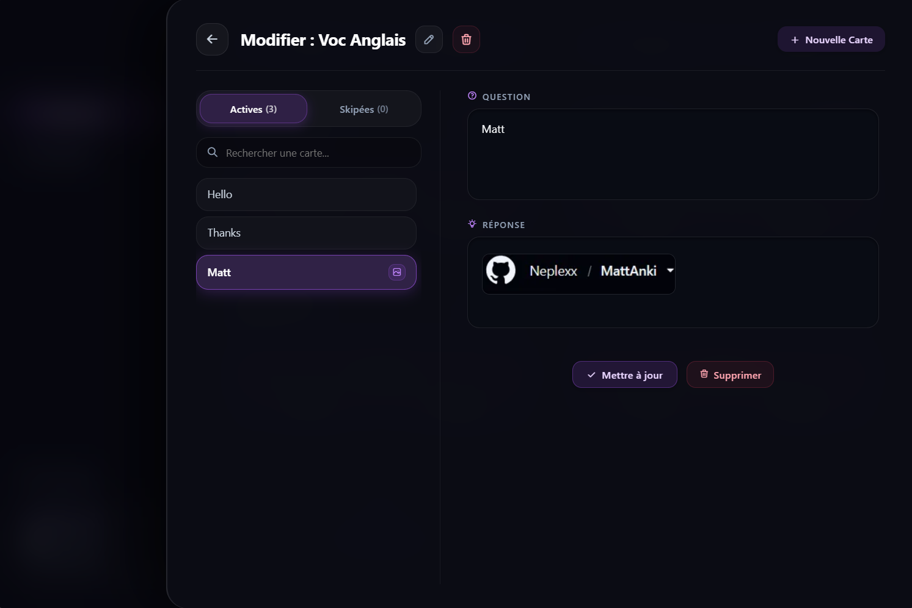
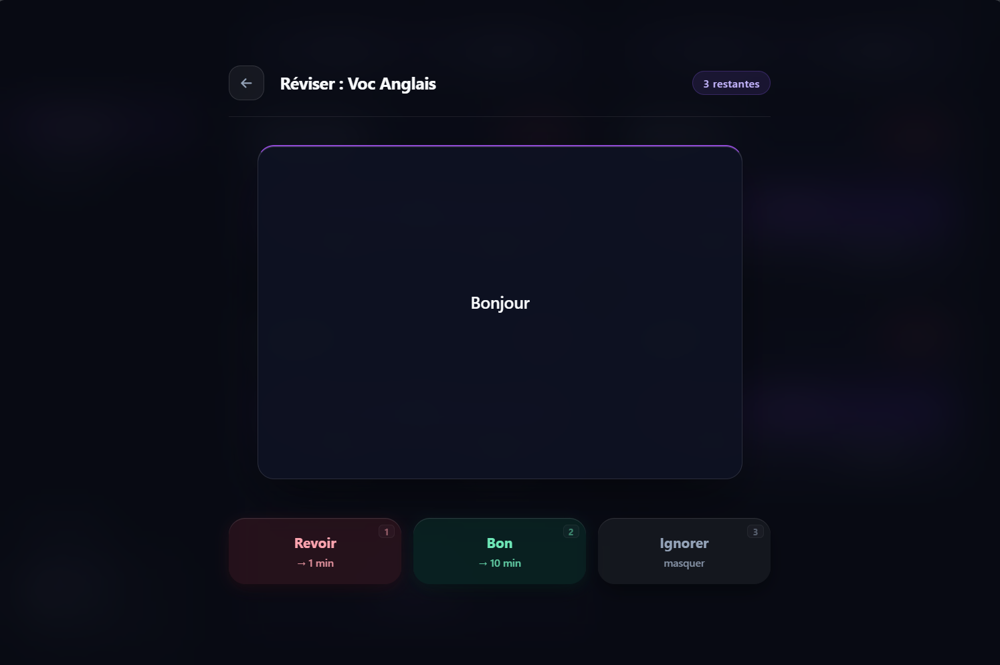
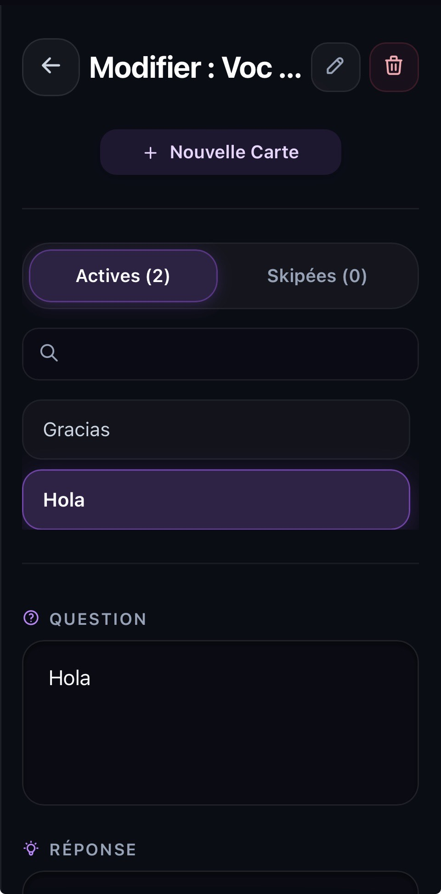
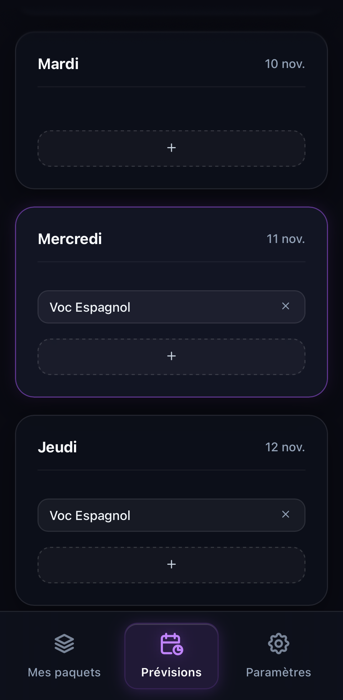
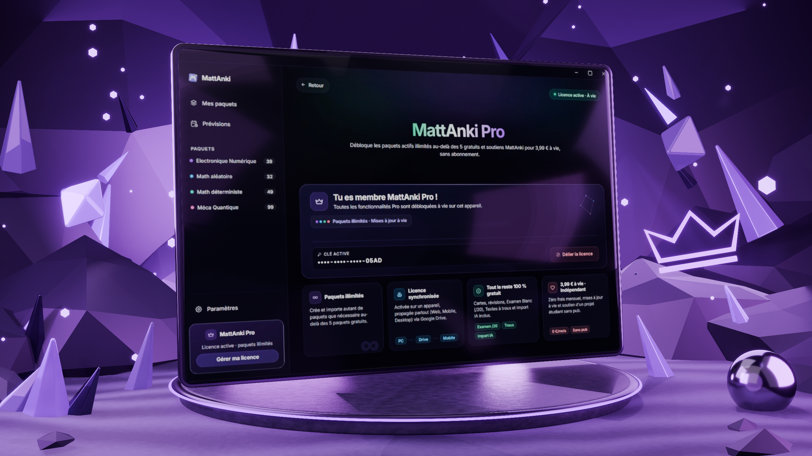
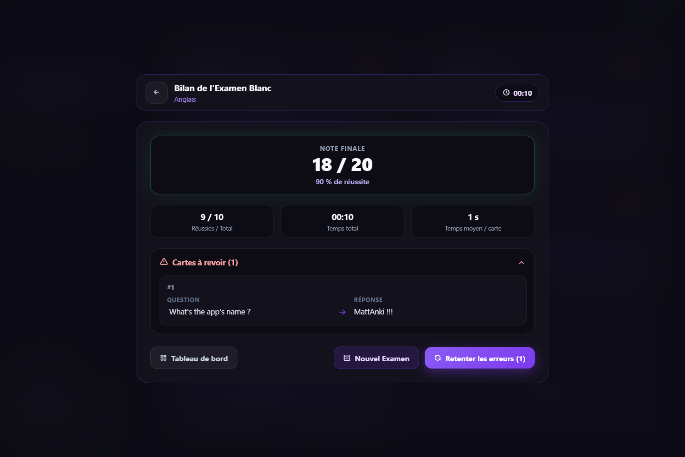

<div align="center">


<h1>Ne laissez plus un algorithme décider de votre réussite.</h1>

<p>
  Les logiciels classiques repoussent vos cartes à 30 jours et vous cachent votre cours juste avant l'examen.<br/>
  <b>MattAnki vous garantit de revoir 100 % de vos cartes actives chaque jour jusqu'au jour J.</b>
</p>

<p>
  <a href="https://neplexx.github.io/MattAnki/"></a>&nbsp;&nbsp;
  <a href="https://github.com/neplexx/MattAnki/releases"></a>&nbsp;&nbsp;
  <a href="https://neplexx-mattanki.lemonsqueezy.com/checkout/buy/1d3cb67f-45f0-4136-8542-e5457ff25e4a"></a>
</p>

<br/>


</div>

<br/>
<br/>

<table width="100%">
  <tr>
    <td width="33%" valign="top">
      <h3 align="center">100 % Déterministe</h3>
      <p align="center">Fini les cartes programmées un mois après votre partiel. Chaque paquet actif est travaillé <b>intégralement tous les jours</b> jusqu'au jour J, avec un bouton <b>Avancé</b> pour réviser hors-planning à volonté.</p>
    </td>
    <td width="33%" valign="top">
      <h3 align="center">Socle Complet Gratuit</h3>
      <p align="center">Créez vos cartes, collez vos schémas en direct avec <kbd>Ctrl</kbd> + <kbd>V</kbd>, importez vos paquets Anki <code>.apkg</code> et synchronisez vos appareils via <b>Google Drive</b> dès la version gratuite.</p>
    </td>
    <td width="33%" valign="top">
      <h3 align="center">Option Pro à 3,99 € à vie</h3>
      <p align="center">Besoin de passer à la vitesse supérieure ? Débloquez les <b>Examens Blancs notés sur 20</b>, l'<b>Import IA</b> en masse, les <b>Textes à trous</b> et les révisions illimitées en un <b>paiement unique</b>.</p>
    </td>
  </tr>
</table>

<br/>

---

<div align="center">
  <h2>1. Le Socle MattAnki — Inclus gratuitement dès l'installation</h2>
  <p>Tout ce dont vous avez besoin au quotidien pour créer, illustrer et synchroniser vos révisions sans débourser un centime.</p>
</div>

<table width="100%">
  <tr>
    <td width="65%" valign="middle" align="center">
      
    </td>
    <td width="35%" valign="middle">
      <p></p>
      <h3>Collage d'images direct (<kbd>Ctrl</kbd> + <kbd>V</kbd>) et Cartes Skipées</h3>
      <p><b>Illustrez vos cours à la vitesse de l'éclair.</b></p>
      <p>Prenez une capture d'écran de votre polycopié ou d'un schéma d'anatomie et faites directement <kbd>Ctrl</kbd> + <kbd>V</kbd> dans la Question ou la Réponse, sans enregistrer de fichier intermédiaire.</p>
      <p>Une carte est désormais connue sur le bout des doigts ? Écartez-la d'une touche vers l'onglet <b>Skipées</b> pour alléger vos séances tout en pouvant la réactiver à tout moment.</p>
    </td>
  </tr>
</table>

<table width="100%">
  <tr>
    <td width="35%" valign="middle">
      <p></p>
      <h3>Révision pilotée au clavier et Mode Avancé</h3>
      <p><b>Zéro distraction. Uniquement vous et votre cours.</b></p>
      <p>Enchaînez vos cartes sans toucher à la souris : <kbd>Espace</kbd> pour retourner la carte, <kbd>1</kbd> pour <b>Revoir dans 10 minutes</b>, <kbd>2</kbd> pour <b>Valider à demain</b>, et <kbd>3</kbd> pour <b>Ignorer</b>.</p>
      <blockquote><b>Le bouton Avancé :</b> Envie de prendre de l'avance ou de refaire un tour complet du paquet la veille du partiel ? Débloquez la session du lendemain en un clic.</blockquote>
    </td>
    <td width="65%" valign="middle" align="center">
      
    </td>
  </tr>
</table>

<table width="100%">
  <tr>
    <td width="65%" valign="middle" align="center">
      
    </td>
    <td width="35%" valign="middle">
      <p></p>
      <h3>Compatibilité Anki (<code>.apkg</code>) et Synchro Google Drive</h3>
      <p><b>Vos paquets vous suivent partout, en toute confidentialité.</b></p>
      <p>Importez directement les paquets Anki (<code>.apkg</code>) partagés par votre fac ou votre prépa et exportez vos propres créations pour vos camarades.</p>
      <p>Reliez votre compte <b>Google Drive</b> en un clic : vos paquets, vos images et votre progression sont sauvegardés dans votre espace privé <code>appDataFolder</code> entre votre PC et votre téléphone.</p>
    </td>
  </tr>
</table>

<br/>

<div align="center">
  <h3>Également inclus gratuitement sur Smartphone (iOS & Android)</h3>
  <p>Installez la Web App sur votre écran d'accueil pour réviser dans les transports, hors-ligne, avec gestes tactiles et agenda hebdomadaire.</p>
</div>

<table width="100%">
  <tr>
    <td width="33%" align="center" valign="top">
      <h4>Gestes Tactiles Intuitifs</h4>
      
      <p>Glissez la carte vers la gauche pour <b>Revoir (10 min)</b> ou vers la droite pour <b>Valider (Demain)</b>.</p>
    </td>
    <td width="33%" align="center" valign="top">
      <h4>Édition & Tri Mobile</h4>
      
      <p>Recherchez un mot-clé instantanément, modifiez vos cartes et gérez vos cartes <b>Actives</b> et <b>Skipées</b>.</p>
    </td>
    <td width="33%" align="center" valign="top">
      <h4>Agenda (« Prévisions »)</h4>
      
      <p>Planifiez quels paquets réviser chaque jour de la semaine et suivez votre barre d'objectif quotidien.</p>
    </td>
  </tr>
</table>

<br/>

---

<div align="center">
  <h2>2. Passez à la vitesse supérieure avec MattAnki Pro</h2>
  <p>
    La version gratuite vous permet de tester l'intégralité du socle (jusqu'à 2 paquets actifs, 50 cartes créées et 50 révisions d'essai par paquet).<br/>
    <b>Pour 3,99 € en paiement unique (sans abonnement), débloquez le tout en illimité ainsi que 3 accélérateurs exclusifs :</b>
  </p>
  <br/>
  <a href="https://neplexx-mattanki.lemonsqueezy.com/checkout/buy/1d3cb67f-45f0-4136-8542-e5457ff25e4a">
    
  </a>
</div>

<br/>

<table width="100%">
  <tr>
    <td width="65%" valign="middle" align="center">
      
    </td>
    <td width="35%" valign="middle">
      <p></p>
      <h3>Mode Examen Blanc noté sur 20</h3>
      <p><b>Testez-vous dans les conditions réelles du partiel.</b></p>
      <p>Lancez une épreuve tirant au sort <b>10, 20 ou 50 questions</b> de votre paquet avec un <b>chronomètre optionnel</b> par carte (15s, 30s, 60s).</p>
      <p>À la fin du test, MattAnki affiche votre <b>note finale sur 20</b>, votre temps de réponse moyen et regroupe toutes vos erreurs pour vous permettre de <b>rejouer uniquement les cartes ratées</b> — sans jamais dérégler votre planning quotidien.</p>
    </td>
  </tr>
</table>

<table width="100%">
  <tr>
    <td width="35%" valign="middle">
      <p></p>
      <h3>Import IA et Texte en un clic</h3>
      <p><b>Transformez votre cours en 50 cartes en dix secondes.</b></p>
      <p>Copiez le <b>prompt IA pré-configuré</b> directement depuis l'application, donnez votre cours à <b>ChatGPT ou Claude</b>, et collez le résultat dans MattAnki.</p>
      <p>Le moteur détecte automatiquement le format (point-virgule, tabulation <b>Quizlet</b> ou <b>Excel</b>), affiche un aperçu en direct et génère l'intégralité de votre paquet instantanément.</p>
    </td>
    <td width="65%" valign="middle" align="center">
      
    </td>
  </tr>
</table>

<table width="100%">
  <tr>
    <td width="65%" valign="middle" align="center">
      
    </td>
    <td width="35%" valign="middle">
      <p></p>
      <h3>Textes à trous rapides (<kbd>Ctrl</kbd> + <kbd>Shift</kbd> + <kbd>C</kbd>)</h3>
      <p><b>Idéal pour les définitions exactes, formules et articles de loi.</b></p>
      <p>Surlignez n'importe quel mot-clé pendant la rédaction d'une carte et cliquez sur <b><code>[...] Texte à trou</code></b>.</p>
      <p>MattAnki génère automatiquement la réponse associée et transforme le mot ciblé en badge masqué pendant vos révisions.</p>
    </td>
  </tr>
</table>

<br/>

### Récapitulatif : Version Découverte vs MattAnki Pro

| Fonctionnalité | Version Découverte (0 €) | MattAnki Pro (3,99 € — Paiement unique) |
| :--- | :--- | :--- |
| **Cycle quotidien déterministe et Mode Avancé** | **Inclus gratuitement** | **Inclus** |
| **Collage d'images instantané (`Ctrl + V`) et Recherche** | **Inclus gratuitement** | **Inclus** |
| **Planificateur hebdomadaire (Prévisions)** | **Inclus gratuitement** | **Inclus** |
| **Synchronisation Cloud (PC, Mac, Linux, iOS, Android)** | **Inclus gratuitement** | **Inclus + Propagation Pro auto via Drive** |
| **Importation et Exportation Anki (`.apkg`)** | **Inclus** (jusqu'à 2 paquets) | **Illimité (sans aucun plafond)** |
| **Nombre de paquets actifs** | Jusqu'à 2 paquets | **Paquets illimités** |
| **Création manuelle de cartes** | Jusqu'à 50 cartes | **Cartes et images illimitées** |
| **Volume de révisions par paquet** | 50 révisions d'essai par paquet | **Révisions quotidiennes 100 % illimitées** |
| **Mode Examen Blanc chronométré et Note sur 20** | Non inclus | **Inclus (avec relecture ciblée des erreurs)** |
| **Import rapide en masse (ChatGPT, Claude, Quizlet)** | Non inclus | **Inclus (avec prompt IA intégré)** |
| **Création de Textes à trous rapides (`[...]`)** | Lecture seule | **Création en un clic (`Ctrl + Shift + C`)** |

<br/>

---

<div align="center">
  <h2>Démonstrations Vidéo (Bureau & Mobile)</h2>
  <p>Découvrez la fluidité de l'application en conditions réelles sur ordinateur et sur smartphone.</p>
</div>

<br/>

<h4 align="center">Version Bureau (Windows, macOS, Linux — Tauri / Rust)</h4>

https://github.com/user-attachments/assets/0d6e7c0c-3ac6-4030-94bd-3760a98e547f

<br/>

<h4 align="center">Version Mobile (iOS & Android — Progressive Web App)</h4>

<table width="100%">
  <tr>
    <td width="25%"></td>
    <td width="50%" align="center">

https://github.com/user-attachments/assets/7815717c-0f34-47ee-98c1-368ba7b5c08b

</td>
    <td width="25%"></td>
  </tr>
</table>

<br/>

---

<div align="center">
  <h2>Achat, Activation et Sécurité de votre Licence</h2>
  <p>Un modèle économique transparent, sans abonnement caché, pensé pour protéger vos révisions et votre budget étudiant.</p>
</div>

```text
1. PAIEMENT SÉCURISÉ (3,99 €)          2. ACTIVATION SUR 1 APPAREIL          3. SYNCHRO AUTOMATIQUE PARTOUT

┌──────────────────────────────┐      ┌──────────────────────────────┐      ┌──────────────────────────────┐
│ Page officielle LemonSqueezy │      │ Onglet Paramètres > Licence  │      │ Connexion Google Drive       │
│ (Stripe / PayPal / ApplePay) │ ───► │ Saisie de la clé reçue :     │ ───► │ Votre téléphone et votre PC  │
│ Réception immédiate de la clé│      │ XXXX-XXXX-XXXX-XXXX          │      │ passent en Pro tout seuls !  │
└──────────────────────────────┘      └──────────────────────────────┘      └──────────────────────────────┘
```

### Comment fonctionnent le paiement et votre clé MattAnki Pro ?

1. **Paiement 100 % sécurisé via Lemon Squeezy et Stripe :** Cliquez sur le bouton d'achat depuis l'application ou via [la page officielle de commande](https://neplexx-mattanki.lemonsqueezy.com/checkout/buy/1d3cb67f-45f0-4136-8542-e5457ff25e4a). La transaction est traitée par **Lemon Squeezy** (notre *Merchant of Record* officiel propulsé par **Stripe**). Aucune coordonnée bancaire ne transite jamais par MattAnki.
2. **Clé de licence instantanée :** Dès la validation du paiement unique de **3,99 €**, votre clé d'activation personnelle (`XXXX-XXXX-XXXX-XXXX`) s'affiche immédiatement à l'écran et vous est envoyée par e-mail avec votre facture officielle.
3. **Activation unique et propagation automatique :** Entrez votre clé une seule fois dans l'onglet **Paramètres** (ou dans la fenêtre MattAnki Pro). Si vous utilisez la synchronisation Google Drive, **votre licence est automatiquement scellée à votre compte et propagée à votre smartphone et à vos autres ordinateurs** sans avoir à ressaisir la clé.
4. **Fonctionnement 100 % Hors-Ligne après activation :** Une fois votre clé validée, MattAnki génère une signature cryptographique locale (`SHA-256`). Vous pouvez réviser dans le train, en avion ou dans un amphithéâtre sans aucune connexion Internet : votre statut Pro reste actif en permanence.
5. **Double sauvegarde anti-perte et liberté d'appareil :** Votre licence est enregistrée simultanément dans votre base SQLite locale et dans le conteneur sécurisé `appDataFolder` de votre Google Drive. Même si vous videz le cache de votre navigateur ou changez de téléphone, votre statut Pro se restaure tout seul. Vous changez d'ordinateur ? Le bouton **Délier la licence** libère votre emplacement en un clic.

| Solution du marché | Modèle économique | Coût réel pour l'étudiant |
| :--- | :--- | :--- |
| **AnkiMobile (iOS)** | Achat unique sur l'App Store | **29,99 €** (valable uniquement sur iPhone/iPad) |
| **Quizlet Plus / Apps SaaS** | Abonnement récurrent | **35,99 € à 45 € / an** (plus de 100 € sur 3 ans d'études) |
| **MattAnki Pro** | **Paiement unique — Accès à vie** | **3,99 € une seule fois** (PC, Mac, Linux, iPhone et Android) |

<br/>

---

<div align="center">
  <h2>Synchronisation Google Drive « Zero-Knowledge » & Confidentialité</h2>
  <p>Vos cours, vos fiches et vos images vous appartiennent à 100 %. MattAnki n'a aucun serveur intermédiaire et ne peut jamais lire vos données.</p>
</div>

```text
[ Application PC (Tauri / Rust) ]  ◄──────┐
                                           │
                                           ▼
                          [ Google Drive : appDataFolder ]
                          (Espace isolé, chiffré et privé)
                                           ▲
                                           │
[ Web App / Mobile PWA (SQLite) ]  ◄──────┘
```

### Pourquoi vos données sont-elles totalement privées et sécurisées ?

- **Architecture directe sans serveur tiers (*Zero-Knowledge*) :** Contrairement aux applications classiques qui stockent vos cartes sur leurs propres bases de données privées, MattAnki synchronise directement vos appareils entre eux via **votre propre compte Google Drive**. En tant que développeur de l'application, **je n'ai techniquement aucun accès à vos paquets, à vos cartes ni à vos fichiers.**
- **Isolation stricte dans le conteneur `appDataFolder` :** Lors de la connexion Google, MattAnki demande uniquement la permission restreinte `drive.appdata`. Cela signifie que l'application travaille dans un dossier système caché et isolé (`appDataFolder`) créé par Google exclusivement pour MattAnki. **MattAnki ne peut ni voir, ni lire, ni modifier aucun de vos documents, photos ou fichiers personnels présents sur votre Google Drive.**
- **Pourquoi MattAnki Pro ne coûte que 3,99 € à vie :** C'est précisément parce que la synchronisation s'appuie sur votre propre espace Google Drive que MattAnki n'a aucun coût de serveur cloud mensuel à vous refacturer sous forme d'abonnement.
- **Moteur natif ultra-rapide et 100 % Offline :** Sur ordinateur, MattAnki tourne nativement grâce à **Rust** et **Tauri v2** (moins de 50 Mo de RAM) avec une base de données **SQLite** locale en mode WAL. Sur navigateur et mobile, vos cartes sont stockées localement via **SQLite WebAssembly / IndexedDB**, vous permettant de réviser instantanément même sans réseau.

<br/>

---

<div align="center">
  <h2>Téléchargement & Installation</h2>
</div>

| Plateforme | Format | Lien direct |
| :--- | :--- | :--- |
| **Navigateur & Mobile (PWA)** | Application Web progressive (iOS, Android, PC) | [**Ouvrir neplexx.github.io/MattAnki**](https://neplexx.github.io/MattAnki/) |
| **Windows** | Installateur `.exe` / `.msi` | [**Télécharger depuis GitHub Releases**](https://github.com/neplexx/MattAnki/releases) |
| **macOS** | Image disque `.dmg` | [**Télécharger depuis GitHub Releases**](https://github.com/neplexx/MattAnki/releases) |
| **Linux** | Paquets `.deb` / `.AppImage` | [**Télécharger depuis GitHub Releases**](https://github.com/neplexx/MattAnki/releases) |
| **Licence MattAnki Pro** | Clé d'activation à vie (Multi-appareils) | [**Acheter une clé officielle (3,99 €)**](https://neplexx-mattanki.lemonsqueezy.com/checkout/buy/1d3cb67f-45f0-4136-8542-e5457ff25e4a) |

<br/>

---

<details>
<summary><b>Spécifications du Protocole de Révision Quotidienne (Comparatif Anki SM-2 vs MattAnki) — Cliquer pour dérouler</b></summary>
<br/>

### Pourquoi remplacer l'espacement exponentiel par un cycle quotidien ?

Les logiciels de répétition espacée traditionnels comme Anki reposent sur des algorithmes d'espacement exponentiel (SM-2, FSRS). Conçus pour étaler l'apprentissage sur plusieurs années, ils deviennent contre-productifs lorsqu'il s'agit de préparer un partiel ou un concours à court terme : **une carte réussie est repoussée à 15 ou 30 jours, sautant ainsi les derniers jours critiques précédant l'épreuve.**

Le moteur de MattAnki remplace les courbes d'oubli opaques par un **double ancrage le premier jour**, suivi d'une **consolidation quotidienne directe** :

```text
[ JOUR 1 : DÉCOUVERTE & ANCRAGE ]
   │
   ├── 1. Première réussite ("Bon") ──────────► Rappel de sécurité à 10 minutes
   │                                            (Vérification de l'ancrage immédiat)
   │
   └── 2. Confirmation après 10 min ("Bon") ──► Carte validée pour aujourd'hui
                                                Programmée automatiquement à DEMAIN
                                                           │
                                                           ▼
[ JOURS SUIVANTS : CONSOLIDATION QUOTIDIENNE ] ◄───────────┘
   │
   ├── Réussite ("Bon" - Touche 2) ───────────► Validée pour la journée -> DEMAIN
   │                                            (1 seul passage réussi par jour suffit)
   │
   ├── Oubli ("Revoir" - Touche 1) ───────────► Boucle immédiate à 10 minutes
   │                                            jusqu'à mémorisation parfaite
   │
   └── Acquise à 100 % ("Ignorer" - Touche 3) ► Écartée dans l'onglet "Skipées"
                                                Réactivable en 1 clic à tout moment
```

| Critère décisif avant un examen | Anki Traditionnel (SM-2 / FSRS) | MattAnki |
| :--- | :--- | :--- |
| **Philosophie de révision** | Espacement exponentiel imprévisible | **Cycle quotidien déterministe (100 % sous contrôle)** |
| **Visibilité du cours à J-3 du partiel** | Partielle (cartes bloquées dans le futur) | **Totale (100 % des cartes actives vues chaque jour)** |
| **Première rencontre d'une carte** | Réglages complexes d'étapes en minutes | **Double validation (immédiate + rappel à 10 min)** |
| **Jours suivants** | Multiplicateurs de facilité punitifs | **1 validation par jour programmée au lendemain** |
| **Écarter une carte connue par cœur** | Suspension manuelle cachée dans l'explorateur | **Touche `3` (Ignorer) rangée dans Skipées** |
| **Forcer une révision supplémentaire** | Création laborieuse d'un paquet filtré | **Bouton « Avancé » instantané en 1 clic** |

</details>

<br/>

---

<div align="center">

[**Politique de confidentialité**](https://neplexx.github.io/MattAnki/privacy) &nbsp;&bull;&nbsp; [**Conditions d'utilisation**](https://neplexx.github.io/MattAnki/terms) &nbsp;&bull;&nbsp; [**Obtenir MattAnki Pro (3,99 €)**](https://neplexx-mattanki.lemonsqueezy.com/checkout/buy/1d3cb67f-45f0-4136-8542-e5457ff25e4a)

<sub>MattAnki — Application disponible en version Découverte gratuite et Licence Pro à vie. Tous droits réservés.</sub>

</div>

