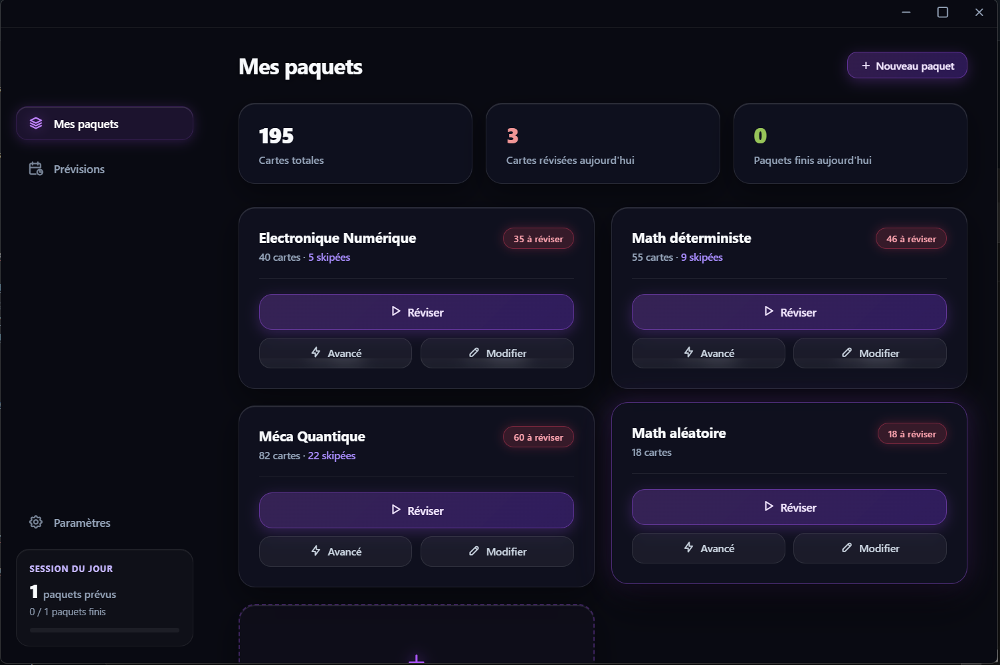
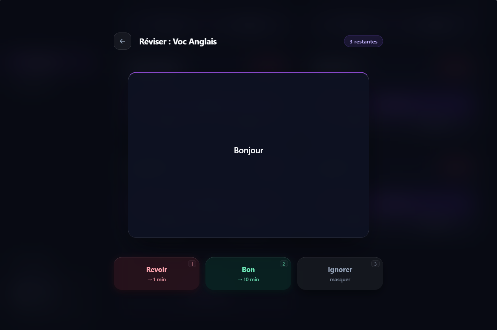
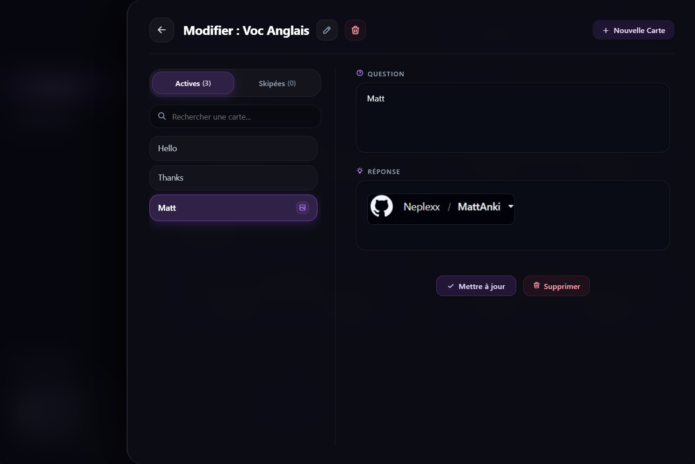
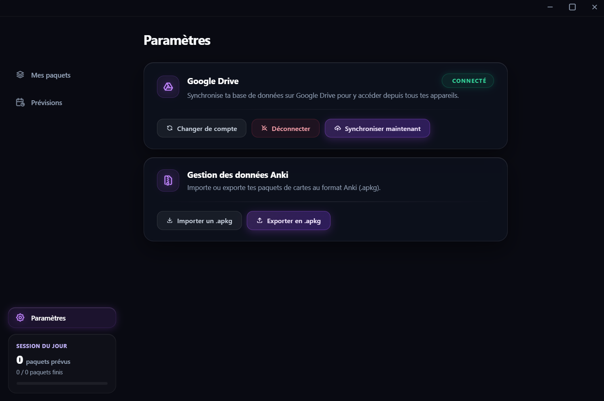
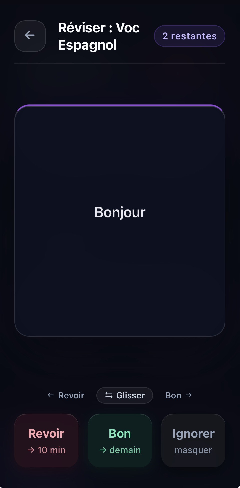
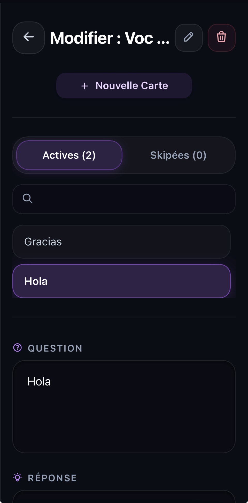
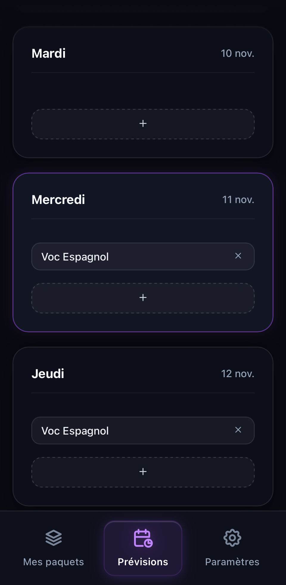

<div align="center">


<br/>

[](https://neplexx.github.io/MattAnki/)
[](https://github.com/neplexx/MattAnki/releases)
[-10b981?style=flat-square&labelColor=13111C)](https://neplexx-mattanki.lemonsqueezy.com/checkout/buy/1d3cb67f-45f0-4136-8542-e5457ff25e4a)
[](https://github.com/neplexx/MattAnki/releases)
[](#synchronisation-zero-knowledge--interopérabilité)

<br/>

[**Accéder à la Web App**](https://neplexx.github.io/MattAnki/) &nbsp;&bull;&nbsp; [**Télécharger sur PC**](https://github.com/neplexx/MattAnki/releases) &nbsp;&bull;&nbsp; [**Le Protocole Quotidien**](#le-protocole-de-révision-quotidienne) &nbsp;&bull;&nbsp; [**Interface & Édition**](#édition-instantanée--interface-bureau) &nbsp;&bull;&nbsp; [**Expérience Mobile**](#expérience-mobile--planning) &nbsp;&bull;&nbsp; [**Accès à Vie (3,99 €)**](#mattanki-pro--un-prix-étudiant-zéro-abonnement)

</div>

<br/>

---

## Pourquoi MattAnki ? La fin de l'incertitude algorithmique

Les logiciels de répétition espacée traditionnels comme Anki reposent sur des algorithmes d'espacement exponentiel (SM-2, FSRS). Conçus pour étaler l'apprentissage sur plusieurs années, ils deviennent contre-productifs lorsqu'il s'agit de préparer un examen, un concours ou un contrôle à court ou moyen terme : **une carte jugée acquise est repoussée à 15 ou 30 jours, sautant ainsi les derniers jours critiques précédant l'épreuve.**

**MattAnki prend le contre-pied total avec une approche déterministe et quotidienne :**

- **Garantie de passage à 100 % :** Chaque paquet actif se révise **tous les jours**. Si votre examen a lieu dans 3 jours, vous avez la certitude mathématique de repasser une fois par jour sur chacune de vos cartes actives d'ici l'épreuve.

- **Zéro charge mentale :** Plus de boutons d'auto-évaluation ambigus (*Difficile*, *Correct*, *Facile*) ni de multiplicateurs d'intervalles imprévisibles. Vous savez ou vous ne savez pas.

- **Contrôle manuel absolu :** Besoin d'anticiper la séance du lendemain ou de refaire un tour complet du paquet la veille d'un partiel ? Un seul bouton déverrouille la session à la demande.


<br/>

## Le Protocole de Révision Quotidienne

Le moteur de MattAnki remplace les courbes d'oubli opaques par un cycle de validation en deux temps le premier jour, suivi d'une consolidation quotidienne directe.

```text
[ PREMIÈRE DÉCOUVERTE D'UNE CARTE ]
   │
   ├── 1. Première validation ("Bon") ────────► Rappel de sécurité à 10 minutes
   │                                            (Ancrage en mémoire de travail)
   │
   └── 2. Revalidation après 10 min ("Bon") ──► Carte validée pour la journée
                                                Programmée pour le LENDEMAIN
                                                           │
                                                           ▼
[ JOURS SUIVANTS (CYCLE QUOTIDIEN) ] ◄─────────────────────┘
   │
   ├── Validation ("Bon" - Touche 2) ─────────► Programmée directement au LENDEMAIN
   │                                            (1 seule validation par jour suffit)
   │
   ├── Échec ("Revoir" - Touche 1) ───────────► Rappel immédiat (10 min)
   │                                            jusqu'à maîtrise complète
   │
   └── Maîtrisée ("Ignorer" - Touche 3) ──────► Carte masquée (placée dans "Skipées")
                                                Réactivable à tout moment dans "Modifier"
```

### Le mode « Avancé » : réviser hors-planning à la demande

Depuis le tableau de bord, chaque paquet dispose d'un bouton **Avancé** aux côtés du bouton **Réviser** principal. Cette fonction permet de :
1. **Simuler le passage au lendemain :** Déclencher immédiatement la session du jour suivant même si toutes les cartes du jour ont déjà été validées.

2. **Repasser sur l'intégralité du paquet :** Enchaîner les tours complets de révision intensive à l'approche d'une échéance sans dérégler la structure du paquet.

| Critère | Anki Classique | MattAnki |
| :--- | :--- | :--- |
| **Logique de planification** | Espacement exponentiel (SM-2 / FSRS) | **Cycle quotidien déterministe** |
| **Visibilité avant une épreuve (J-3)** | Partielle (cartes repoussées après l'examen) | **Totale (100 % des cartes actives vues chaque jour)** |
| **Validation d'une nouvelle carte** | Paramètres d'étapes complexes | **Validation initiale + confirmation à 10 min** |
| **Validation les jours suivants** | Calcul de facteur de facilité | **1 validation par jour -> renvoie au lendemain** |
| **Mise à l'écart des acquis** | Suspension manuelle dans l'explorateur | **Bouton « Ignorer » direct (onglet Skipées)** |
| **Révision supplémentaire** | Création d'un paquet filtré personnalisé | **Bouton « Avancé » en un clic** |

<br/>

---

## Édition Instantanée & Interface Bureau

L'interface de MattAnki a été pensée autour d'une palette sombre profonde (`#0d0b14`) réhaussée d'accents violets (`#7c3aed`), réduisant la fatigue visuelle lors des sessions nocturnes tout en mettant en valeur l'état de progression.

<table width="100%">
  <tr>
    <td width="50%" valign="top">
      <h4 align="center">Tableau de bord & Suivi global</h4>
      
      <p align="center"><sub>Vue d'ensemble des cartes totales, révisées du jour, paquets terminés et suivi de la session quotidienne en barre latérale.</sub></p>
    </td>
    <td width="50%" valign="top">
      <h4 align="center">Session de révision sans distraction</h4>
      
      <p align="center"><sub>Navigation intégralement pilotable au clavier (Touches 1, 2, 3) avec retour visuel immédiat sur l'échéance de chaque choix.</sub></p>
    </td>
  </tr>
  <tr>
    <td width="50%" valign="top">
      <h4 align="center">Éditeur rapide & Collage d'images (Ctrl+V)</h4>
      
      <p align="center"><sub>Capturez n'importe quel schéma ou cours à l'écran et faites directement <b>Ctrl + V</b> dans le champ Question ou Réponse. Gestion dédiée des cartes <b>Actives</b> et <b>Skipées</b>.</sub></p>
    </td>
    <td width="50%" valign="top">
      <h4 align="center">Synchronisation Cloud & Fichiers .apkg</h4>
      
      <p align="center"><sub>Connexion Google Drive directe et importation / exportation native de vos paquets au format universel Anki (<code>.apkg</code>).</sub></p>
    </td>
  </tr>
</table>

### Points clés de l'éditeur et de la gestion des cartes
- **Intégration d'images par Presse-Papiers (`Ctrl + V`) :** Plus besoin d'enregistrer un fichier image sur le disque avant de l'importer. Prenez une capture d'écran de votre cours, cliquez dans la zone de texte et collez directement avec `Ctrl + V`.

- **Gestion granulaire des cartes « Skipées » :** Lorsqu'une carte est parfaitement connue, cliquer sur **Ignorer** pendant une révision la masque immédiatement. Elle reste accessible à tout moment dans l'onglet **Skipées** du menu **Modifier** du paquet pour être réactivée en un clic.

- **Import / Export `.apkg` sur PC :** Récupérez n'importe quel paquet existant depuis Anki ou partagez vos propres créations avec vos camarades grâce à l'export `.apkg` complet.


<br/>

---

### Démonstration — Version Bureau (Tauri / Rust)

https://github.com/user-attachments/assets/a197f4c8-5e57-411b-ba5c-2696ebaa2070

<br/>

---

## Expérience Mobile & Planning

Sur smartphone, MattAnki fonctionne comme une application native via sa Progressive Web App (PWA), avec prise en charge des gestes tactiles (*glisser à gauche pour Revoir, glisser à droite pour Bon*) et un planificateur de sessions dédié.

<br/>

<table width="100%">
  <tr>
    <td width="25%" align="center" valign="top">
      <b>Mes Paquets</b><br/><br/>
      
      <sub>Accès direct aux révisions, au mode Avancé et au compteur de cartes skipées.</sub>
    </td>
    <td width="25%" align="center" valign="top">
      <b>Gestes Tactiles</b><br/><br/>
      
      <sub>Validation par boutons ou balayage horizontal (Glisser vers Revoir / Bon).</sub>
    </td>
    <td width="25%" align="center" valign="top">
      <b>Édition & Skipées</b><br/><br/>
      
      <sub>Recherche instantanée, création de cartes et bascule entre cartes Actives et Skipées.</sub>
    </td>
    <td width="25%" align="center" valign="top">
      <b>Planning (« Prévisions »)</b><br/><br/>
      
      <sub>Construction de l'emploi du temps par jour avec assignation des paquets à réviser.</sub>
    </td>
  </tr>
</table>

### Organisez vos semaines avec l'onglet « Prévisions »
L'onglet **Prévisions** agit comme un véritable agenda de révision : assignez précisément quels paquets doivent être travaillés chaque jour de la semaine (Mardi, Mercredi, Jeudi...). Le compteur **Session du jour** suit alors en temps réel la complétion des paquets prévus pour votre journée.

<div align="center">

### Démonstration — Version Mobile (PWA)

https://github.com/user-attachments/assets/af3c421a-1494-44e4-b860-a5763cbdb1fd

</div>

<br/>

---

## MattAnki Pro — Un prix étudiant, zéro abonnement

Pourquoi la plupart des applications d'étude facturent-elles des abonnements mensuels hors de prix ? Parce qu'elles hébergent vos données sur leurs propres serveurs cloud coûteux. **Grâce à son architecture *Zero-Knowledge* qui s'appuie directement sur l'espace privé de votre propre Google Drive, MattAnki n'a aucun frais de serveur mensuel à vous répercuter.**

Vous pouvez découvrir et utiliser MattAnki gratuitement sans limite de durée, puis débloquer l'intégralité du logiciel **à vie** pour le prix d'un café : **3,99 € en paiement unique**.

### Comparatif : Version Découverte vs MattAnki Pro (Accès à vie)

| Fonctionnalité | Version Découverte (0 €) | MattAnki Pro (3,99 € — Paiement unique) |
| :--- | :---: | :---: |
| **Algorithme de révision quotidien déterministe** | Inclus | **Inclus** |
| **Collage d'images instantané (`Ctrl + V`) & Recherche** | Inclus | **Inclus** |
| **Planificateur hebdomadaire (« Prévisions »)** | Inclus | **Inclus** |
| **Nombre de paquets actifs** | Jusqu'à 2 paquets | **Paquets illimités** |
| **Nombre de cartes mémoire** | Jusqu'à 50 cartes | **Cartes & images illimitées** |
| **Mode « Avancé » (Forcer les révisions du lendemain / Révision intensive)** | Inclus | **Débloqué en illimité** |
| **Importation & Exportation universelle Anki (`.apkg`)** | Verrouillé | **Débloqué (Import & Export complets)** |
| **Synchronisation multi-appareils (PC, Mac, Linux, iOS, Android)** | Inclus | **Inclus + Déverrouillage Pro automatique via Drive** |

### Pourquoi 3,99 € est imbattable sur le marché ?

| Solution | Modèle économique | Coût réel pour l'étudiant |
| :--- | :--- | :--- |
| **AnkiMobile (iOS)** | Achat unique sur l'App Store | **29,99 €** (uniquement pour iPhone/iPad) |
| **Quizlet Plus / Apps SaaS** | Abonnement récurrent | **~35,99 € à 45 € / an** (soit plus de 100 € sur 3 ans d'études) |
| **MattAnki Pro** | **Paiement unique — Accès à vie** | **3,99 € une seule fois** (valable sur PC, Mac, Linux, iPhone et Android) |

<br/>

### Comment fonctionne l'achat et l'activation ? (En 30 secondes)

```text
1. PAIEMENT SÉCURISÉ (3,99 €)          2. ACTIVATION SUR 1 APPAREIL          3. SYNCHRO AUTOMATIQUE PARTOUT
┌──────────────────────────────┐      ┌──────────────────────────────┐      ┌──────────────────────────────┐
│ Page officielle LemonSqueezy │      │ Onglet Paramètres > Licence  │      │ Connexion Google Drive       │
│ (Stripe / PayPal / ApplePay) │ ───► │ Saisie de la clé reçue :     │ ───► │ Votre téléphone et votre PC  │
│ Réception immédiate de la clé│      │ XXXX-XXXX-XXXX-XXXX          │      │ passent en Pro tout seuls !  │
└──────────────────────────────┘      └──────────────────────────────┘      └──────────────────────────────┘
```

1. **Paiement 100 % sécurisé via Lemon Squeezy & Stripe :** Cliquez sur le bouton d'achat depuis l'application ou via [la page officielle de commande](https://neplexx-mattanki.lemonsqueezy.com/checkout/buy/1d3cb67f-45f0-4136-8542-e5457ff25e4a). La transaction est traitée par **Lemon Squeezy** (notre *Merchant of Record* officiel propulsé par **Stripe**). Aucune coordonnée bancaire ne transite jamais par MattAnki.
2. **Clé de licence instantanée :** Dès validation du paiement, votre clé personnelle (`XXXX-XXXX-XXXX-XXXX`) s'affiche immédiatement à l'écran et vous est envoyée par e-mail avec votre facture officielle (garantie à vie en cas de changement d'ordinateur).
3. **Activation unique & Propagation automatique :** Entrez votre clé une seule fois dans l'onglet **Paramètres** (ou dans la fenêtre MattAnki Pro). Si vous utilisez la synchronisation Google Drive, **votre licence est automatiquement scellée et propagée à votre smartphone et à vos autres ordinateurs** sans même avoir à ressaisir la clé.

### Une architecture de licence fiable, résiliente et de confiance
- **Fonctionnement 100 % Hors-Ligne après activation :** Une fois votre clé activée, MattAnki génère une signature cryptographique locale (`SHA-256`). Vous pouvez réviser dans le train, en avion ou dans un amphithéâtre sans aucune connexion Internet : votre statut Pro reste actif en permanence.
- **Double sauvegarde anti-perte :** Votre licence est sauvegardée simultanément dans le stockage local, dans votre base de données SQLite et dans le conteneur sécurisé `appDataFolder` de votre Google Drive. Même si vous videz le cache de votre navigateur ou changez de téléphone, votre statut Pro se restaure automatiquement.
- **Gestion libre de vos appareils :** Vous changez d'ordinateur ? Un bouton **Délier la licence** dans les paramètres vous permet de libérer votre emplacement en un clic pour réactiver votre clé sur votre nouvelle machine.

<div align="center">
<br/>

[-7c3aed?style=for-the-badge&labelColor=13111C)](https://neplexx-mattanki.lemonsqueezy.com/checkout/buy/1d3cb67f-45f0-4136-8542-e5457ff25e4a)

</div>

<br/>

---

## Synchronisation Zero-Knowledge & Interopérabilité

MattAnki fonctionne sans aucun serveur intermédiaire propriétaire. Vos cartes, vos images et votre planning vous appartiennent intégralement.

```text
[ Application PC (Tauri / Rust) ]  ◄──────┐
                                           │
                                           ▼
                          [ Google Drive : appDataFolder ]
                          (Espace isolé, chiffré et privé)
                                           ▲
                                           │
[ Web App / Mobile PWA (SQLite) ]  ◄──────┘
```

- **Confidentialité absolue (`appDataFolder`) :** L'application utilise exclusivement le conteneur caché `appDataFolder` de votre propre Google Drive. MattAnki ne peut ni voir ni accéder au reste de vos fichiers Google Drive.

- **Moteur natif ultra-léger :** Propulsé par **Rust** et **Tauri v2** sur ordinateur (< 50 Mo de RAM) et par **SQLite WebAssembly** sur navigateur pour un fonctionnement 100 % hors-ligne entre deux synchronisations.


<br/>

---

## Téléchargement & Installation

| Plateforme | Format | Lien direct |
| :--- | :--- | :--- |
| **Navigateur & Mobile (PWA)** | Application Web progressive (iOS, Android, PC) | [**Ouvrir neplexx.github.io/MattAnki**](https://neplexx.github.io/MattAnki/) |
| **Windows** | Installateur `.exe` / `.msi` | [**Télécharger depuis GitHub Releases**](https://github.com/neplexx/MattAnki/releases) |
| **macOS** | Image disque `.dmg` | [**Télécharger depuis GitHub Releases**](https://github.com/neplexx/MattAnki/releases) |
| **Linux** | Paquets `.deb` / `.AppImage` | [**Télécharger depuis GitHub Releases**](https://github.com/neplexx/MattAnki/releases) |
| **Licence MattAnki Pro** | Clé d'activation à vie (Multi-appareils) | [**Acheter une clé officielle (3,99 €)**](https://neplexx-mattanki.lemonsqueezy.com/checkout/buy/1d3cb67f-45f0-4136-8542-e5457ff25e4a) |

<details>
<summary><b>Instructions d'installation sur iOS (iPhone / iPad) et Android</b></summary>
<br/>

1. **Sur iOS (Safari) :** Ouvrez [https://neplexx.github.io/MattAnki/](https://neplexx.github.io/MattAnki/), appuyez sur le bouton **Partager** dans la barre inférieure, puis sélectionnez **Sur l'écran d'accueil**.

2. **Sur Android (Chrome) :** Ouvrez [https://neplexx.github.io/MattAnki/](https://neplexx.github.io/MattAnki/), appuyez sur le menu en haut à droite, puis sélectionnez **Installer l'application**.

</details>

<br/>

---

<div align="center">

[**Politique de confidentialité**](https://neplexx.github.io/MattAnki/privacy) &nbsp;&bull;&nbsp; [**Conditions d'utilisation**](https://neplexx.github.io/MattAnki/terms) &nbsp;&bull;&nbsp; [**Obtenir MattAnki Pro (3,99 €)**](https://neplexx-mattanki.lemonsqueezy.com/checkout/buy/1d3cb67f-45f0-4136-8542-e5457ff25e4a)

<sub>MattAnki — Application disponible en version Découverte gratuite et Licence Pro à vie. Tous droits réservés.</sub>

</div>
